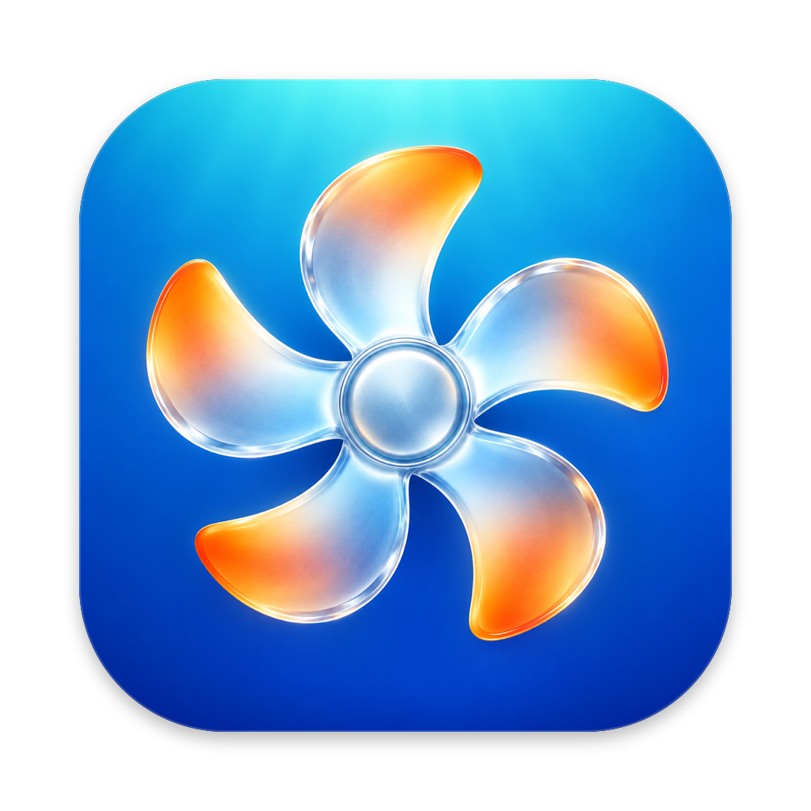
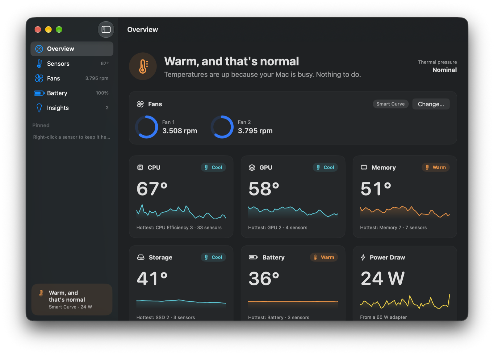
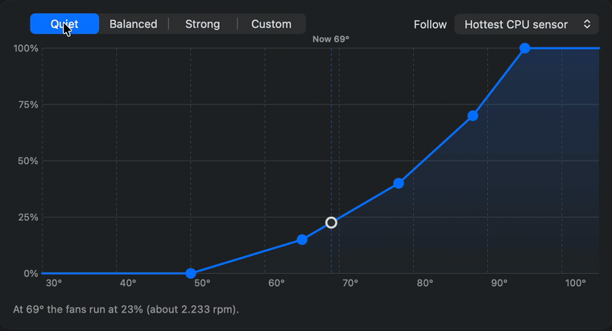
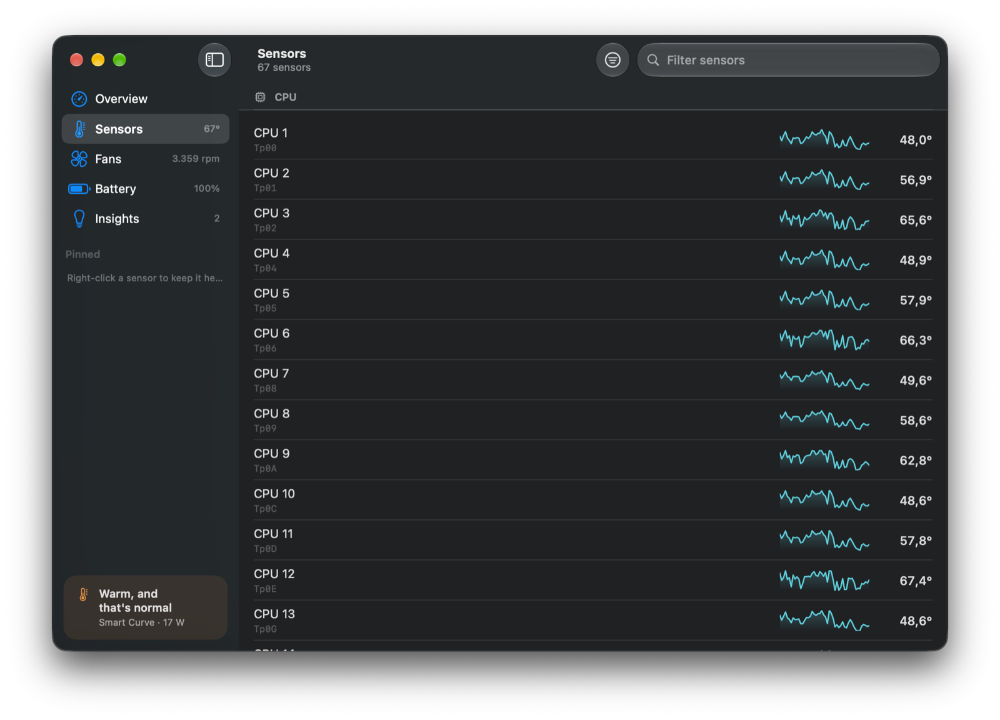
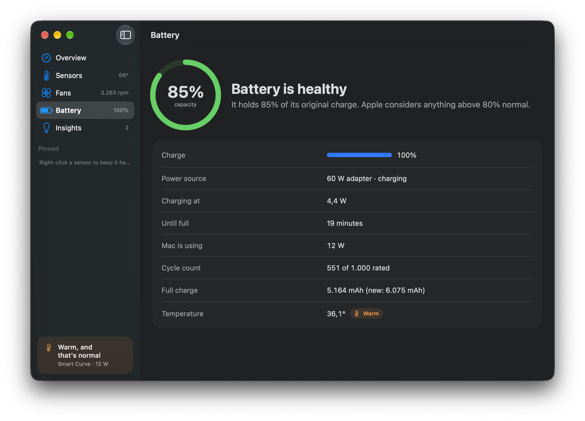

<p align="center">
  
</p>

<h1 align="center">MacFan</h1>

<p align="center">
  <b>Free, open-source temperature monitor and fan control for the Mac.</b><br>
  Apple Silicon (M1 to M5) and Intel. No subscription, no account, no tracking.
</p>

<p align="center">
  <a href="https://github.com/alvinmr/macfan/releases/latest"></a>
  <a href="https://github.com/alvinmr/macfan/releases"></a>
  
  <a href="LICENSE"></a>
  <a href="https://github.com/alvinmr/macfan/stargazers"></a>
</p>

<p align="center">
  <a href="https://github.com/alvinmr/macfan/releases/latest/download/MacFan-macOS.dmg"><b>⬇ Download MacFan</b></a>
  &nbsp;·&nbsp;
  <code>brew install --cask alvinmr/tap/macfan</code>
</p>

<p align="center">
  
</p>

<p align="center">
  <i>If MacFan keeps your Mac cool, a ⭐ helps other Mac owners find it.</i>
</p>

## Why MacFan

- **It tells you if your Mac is OK.** Not just numbers: "Running cool", "Warm, and
  that's normal", "Running hot", with what to do about it, including when macOS is
  slowing your Mac down to cool off.
- **It shows what's making it warm.** The apps using the most CPU, right next to the
  temperature.
- **You choose how the fans behave.** Leave it to macOS, draw your own temperature
  curve, pick a fixed speed, or go full blast.
- **It stays out of the way.** Under 2% CPU with the window open, close to nothing from
  the menu bar.
- **It's safe by default.** Fans go back to macOS when you quit, when the Mac sleeps,
  if MacFan crashes, and whenever a part gets critically hot.
- **It's free and open.** MIT licensed, no account, no analytics, and the code that runs
  as root is under 200 lines you can read.

## Features

<p align="center">
  
</p>

<p align="center">
  
  
</p>

**Monitoring**
- Every sensor, grouped: CPU, GPU, memory, SSD, battery, power, wireless and enclosure,
  each with a 10-minute sparkline and sensible per-part thresholds (a 90 °C CPU is fine;
  a 50 °C battery is not).
- One-hour history charts for any card, fan or sensor, with average and peak.
- Power draw in watts, plus charge or drain rate and time left on laptops.
- Battery health: capacity vs. new, cycle count, temperature, and a clear verdict.

**Fan control**
- *Automatic* (macOS decides), *Smart Curve* (Quiet, Balanced, Strong, or drag the
  points to draw your own), *Fixed Speed* and *Full Speed*.
- Switch modes on their own when you plug in or unplug.

**Insights**
- *Hot moments*: each time your Mac ran hot or throttled, and which apps were busy.
- *Cooling Health*: learns how your Mac normally cools over two weeks, then flags when
  it gets worse, the usual sign of dust in the vents. Kept only on your Mac.

**Everyday**
- Menu bar with temperature, fan speed or both; pin any sensor there or in the sidebar.
- Alerts that stay rare enough to mean something: after 30 s above your threshold, at
  most every 15 minutes.
- CSV logging, one file per day.
- Signed automatic updates with [Sparkle](https://sparkle-project.org).
- `macfanctl` command-line tool for scripts and bug reports.

## Install

Runs on **macOS 14 Sonoma or later**, on **Apple Silicon and Intel**, from one download.

**Homebrew**

```sh
brew install --cask alvinmr/tap/macfan
```

**Or download the DMG** from the [latest release](https://github.com/alvinmr/macfan/releases/latest),
open it and drag **MacFan** to **Applications**.

MacFan is not yet notarized by Apple, so macOS blocks it the first time. If you trust
the download, open **System Settings → Privacy & Security** and click **Open Anyway**.
You only do this once. Each release lists the DMG's SHA-256 so you can check it:

```sh
shasum -a 256 ~/Downloads/MacFan-v*-macOS.dmg
```

MacFan updates itself once a day (verified by signature). Check now from
**MacFan → Check for Updates…**, or turn it off in **Settings → General**.

## Fan control and safety

Reading temperatures needs no permission. Changing fan speed needs root, so the first
time you pick a mode other than Automatic, MacFan installs a small helper and macOS asks
you to allow it under **System Settings → General → Login Items**.

The helper can do exactly three things: report its version, set a fan target, and give
the fans back to macOS. It only talks to the signed MacFan app, and returns every fan to
macOS if the app quits, disconnects, or goes silent for 20 seconds. MacFan never sets a
fan below the firmware's minimum. Remove the helper any time from **Settings → Helper**.

Details, and what to do if the helper doesn't respond, are in
[docs/BUILDING.md](docs/BUILDING.md#the-privileged-helper).

## FAQ

**Will it work on my Mac?** Any Mac on macOS 14 or later, Apple Silicon from M1 to M5
and Intel. If something looks wrong on yours, please
[open an issue](https://github.com/alvinmr/macfan/issues/new) with your Mac model.

**Fan control stopped working after an update.** macOS can keep trusting the previous
helper after MacFan updates itself. Open **Fans** and click **Reset Helper…** (it asks for
your password), or restart your Mac. If the helper still doesn't respond, see
[the helper troubleshooting notes](docs/BUILDING.md#the-helper-is-registered-but-isnt-responding).

**A sensor has a generic name like "Sensor TC2X".** MacFan doesn't know that key yet.
Naming it is usually a one-line change, see [Adding sensors](docs/ADDING_SENSORS.md).

**Does it send anything anywhere?** No. MacFan has no analytics and makes no network
requests apart from Sparkle's update check, which you can turn off.

**Can I script it?** Yes, with `macfanctl`. See [docs/BUILDING.md](docs/BUILDING.md#command-line).

## Contributing

Bug reports, sensor names for your Mac, and pull requests are all welcome. See
[CONTRIBUTING.md](CONTRIBUTING.md), and [docs/BUILDING.md](docs/BUILDING.md) to build
from source.

If MacFan is useful to you, **[starring the repo](https://github.com/alvinmr/macfan/stargazers)**
is the easiest way to help. It's how other people find it.

## Disclaimer

Changing fan speeds is at your own risk. MacFan hands control back to macOS whenever
something looks wrong, but no software can promise your hardware is safe.

MacFan is not affiliated with Apple or with Tunabelly Software (TG Pro).

## License

[MIT](LICENSE)
